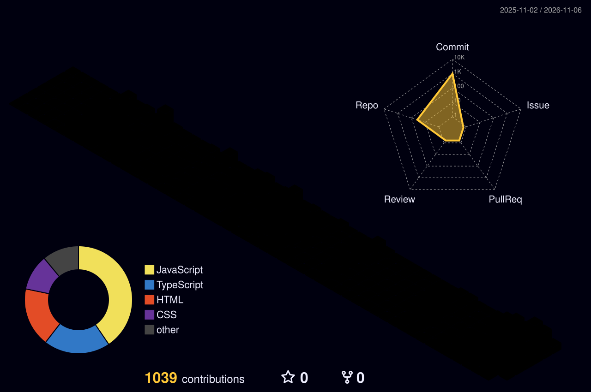

<a name="top"></a>

<!-- Header Animado -->
<div align="center">


</div>

<!-- Typing Effect Profissional -->
<div align="center">

<a href="https://git.io/typing-svg">
  
</a>

<br><br>

</div>

<!-- Social Badges -->
<div align="center">

<a href="https://www.linkedin.com/in/victormartinsd/">
  
</a>
<a href="https://github.com/VictorMartinsD?tab=repositories">
  
</a>
<a href="https://victormartinsd.github.io/portfolio-dev/">
  
</a>

</div>
<br><br>

<!-- Contadores Profissionais -->
<div align="center">

[](https://wakatime.com/@9b6c8f48-1b50-43da-8c4a-c608e35762a8)

<br>
</div>

<!-- Menu de Navegação Rápida -->
<div align="center">

  <table align="center">
    <tr>
      <td align="center"><a href="#sobre"><kbd> <br> Sobre <br> </kbd></a></td>
      <td align="center"><a href="#toolbox"><kbd> <br> Toolbox <br> </kbd></a></td>
      <td align="center"><a href="#expertise"><kbd> <br> Skills <br> </kbd></a></td>
      <td align="center"><a href="#certificados"><kbd> <br> Certificados <br> </kbd></a></td>
    </tr>
    <tr>
      <td align="center"><a href="#projetos"><kbd> <br> Projetos <br> </kbd></a></td>
      <td align="center"><a href="#stats"><kbd> <br> Stats <br> </kbd></a></td>
      <td align="center"><a href="#carreira"><kbd> <br> Carreira <br> </kbd></a></td>
      <td align="center"><a href="#contato"><kbd> <br> Contato <br> </kbd></a></td>
    </tr>
  </table>

</div>
<br>


<!-- Sobre Mim (Objeto JS) -->

<a name="sobre"></a>

<div align="center">

## 👤 Sobre Mim

</div>

> Sou formado em **Sistemas de Informação** e desenvolvedor web focado em **Frontend**. Gosto de entender o problema antes de construir a solução e aprendo na prática: estudo, crio projetos, testo e ajusto. Também olho para o produto além do código, priorizando a experiência do usuário e transformando necessidades em **requisitos claros**.

```javascript
const victor = {
  nome: "Victor Martins Dias",
  foco_atuação: "Desenvolvimento Web Frontend | Produto Digital",

  objetivo_profissional: `Criar e evoluir soluções web alinhadas às necessidades de 
  usuários e produtos digitais, com foco em evoluir para IA aplicada 
  à produtividade e automação`,

  global_skills: {
    idioma:
      "Inglês (B1 - Intermediário geral: leitura, escrita, fala e escuta)",
    competencias: [
      "React e componentização de interfaces",
      "JavaScript ES6+ e TypeScript",
      "HTML5, CSS3 e design responsivo",
      "Documentação técnica e requisitos de produto",
      "Engenharia de Prompt e uso de IA generativa no desenvolvimento",
    ],
  },
};
```

---

<!-- Toolbox e Tecnologias -->
<div align="center">
<a name="toolbox"></a>

## 🛠️ Toolbox & Tecnologias

### 👨‍💻 Desenvolvimento Core, Frontend & Backend

<p>
  
  
  
  
  
  
</p>

### 🌐 APIs, Dados & Qualidade

<p>
  
  
  
  
  
  
  
  
  
</p>

### 🔍 Tooling & Code Quality

<p>
  
  
  
  
  
  
  
  
  
</p>

### 🚀 Versionamento e Deploy

<p>
  
  
  
  
  
</p>

### 🧰 Ferramentas & Fluxo de Trabalho

<p>
  
  
  
  
  
  
  
</p>

### 📦 Ferramentas Complementares

<p>
  
  
  
  
  
</p>

### 💡 Competências Técnicas & Diferenciais

<p>
  
  
  
  
  
  
  
  
  
  
  
  
  
</p>

### 🎯 Próximos Objetivos de Estudo

<p>
  
  
</p>

</div>

---

<!-- Produto, IA & Automação -->

<a name="expertise"></a>

<div align="center">

## 🧭 Produto, IA & Automação

<sub>Iniciativas que complementam minha atuação em desenvolvimento web</sub>

<table align="center" width="100%">
  <tr>
    <td width="33%" valign="top">
      <h3 align="center">💡 Documentação de Produto</h3>
      <p>
        Estruturação de visão, requisitos, regras de negócio e fluxos
        para orientar a implementação dos projetos.
      </p>
      <p align="center">
        <a href="https://github.com/VictorMartinsD/react-forms/blob/main/docs/product-spec.md">
          
        </a>
      </p>
    </td>
    <td width="33%" valign="top">
      <h3 align="center">🤖 IA & Produtividade</h3>
      <p>
        Uso de IA generativa e engenharia de prompt como apoio
        à pesquisa, depuração e documentação durante o desenvolvimento.
      </p>
    </td>
    <td width="33%" valign="top">
      <h3 align="center">⚙️ Automação</h3>
      <p>
        Workflows para atualizar o README, verificar links, executar
        lint e formatação e abrir issues quando uma execução falha.
      </p>
      <p align="center">
        <a href="https://github.com/VictorMartinsD/VictorMartinsD/tree/main/.github/workflows">
          
        </a>
      </p>
    </td>
  </tr>
</table>

</div>

---

<!-- Diplomas e Certificações -->
<div align="center">
<a name="certificados"></a>

## 🏆 Conquistas & Certificações

  

</div>
<br>

<table align="center" border="0">
  <tr>
    <td align="center" valign="top" width="220">
      <a href="https://app.rocketseat.com.br/certificates/52a1eaf1-44d1-4e24-8f85-9aa8c68cff43" target="_blank">
        <br>
        <sub><b>JavaScript</b><br>Rocketseat</sub>
      </a>
    </td>
    <td align="center" valign="top" width="220">
      <a href="https://consultadiploma.estacio.br/diploma/163.163.1921d345a70e" target="_blank">
        <br>
        <sub><b>Bacharel em Sistemas de Informação</b><br>Estácio</sub>
      </a>
    </td>
    <td align="center" valign="top" width="220">
      <a href="https://app.rocketseat.com.br/certificates/4100a3ab-fa10-4b5d-b74d-0d7a7048d5f8" target="_blank">
        <br>
        <sub><b>HTML e CSS</b><br>Rocketseat</sub>
      </a>
    </td>
    <td align="center" valign="top" width="220">
      <a href="https://app.rocketseat.com.br/certificates/241baee8-a9ea-4de8-930e-b0bac3ac25a3" target="_blank">
        <br>
        <sub><b>Inglês para Devs</b><br>Rocketseat</sub>
      </a>
    </td>
  </tr>
</table>

<div align="center">
<details>
  <summary align="center"><b>📂 Clique para expandir outros certificados relevantes</b></summary>
  <br>
  <table align="center" border="0">
    <tr>
      <td align="center" valign="top" width="220">
        <a href="https://cert.efset.org/en/Qv7k7Y" target="_blank">
          <br>
          <sub><b>EF SET English</b><br>B1 Intermediate</sub>
        </a>
      </td>
      <td align="center" valign="top" width="220">
        <a href="https://app.rocketseat.com.br/certificates/faf321bf-b930-4fb8-b876-98361bd1a4fa" target="_blank">
          <br>
          <sub><b>Engenharia de Prompt</b><br>Rocketseat</sub>
        </a>
      </td>
      <td align="center" valign="top" width="220">
        <a href="https://app.rocketseat.com.br/certificates/f868f4fd-6055-4e7f-b103-f195f8216f60" target="_blank">
          <br>
          <sub><b>Mentoria de Carreira</b><br>Rocketseat</sub>
        </a>
      </td>
      <td align="center" valign="top" width="220">
        <a href="https://www.linkedin.com/in/victormartinsd/overlay/Position/1312780318/treasury/?profileId=ACoAACUx_T0BZVBdW3GUllnwWrTOAiyfSyKC6Us" target="_blank">
          <br>
          <sub><b>Estágio de Nível Superior</b><br>Instituto Nacional do Seguro Social (INSS)</sub>
        </a>
      </td>
    </tr>
  </table>
</details>
</div>

<div align="center">
  <br>
  <a href="https://www.linkedin.com/in/victormartinsd/details/certifications/" target="_blank">
    
  </a>
</div>

---

<!-- Projetos em Destaque -->
<div align="center">
<a name="projetos"></a>

## 🚀 Projetos em Destaque

<table width="100%">
  <tr>
    <td width="50%" valign="top">
      <h3>📋 React Forms</h3>
      <p><i>Formulário responsivo com validação e rascunho persistido</i></p>
      
      
      
      
      
      
      
      
      
      <ul>
        <li>Formulário tipado com <code>React Hook Form</code> e validação declarativa com <code>Yup</code>.</li>
        <li>Horários derivados da data, com bloqueio de domingos e datas inválidas.</li>
        <li>Rascunho persistido em <code>localStorage</code> via <code>Zustand</code>.</li>
      </ul>
      <br>
      <a href="https://github.com/VictorMartinsD/react-forms"></a>&nbsp;&nbsp;&nbsp;
      <a href="https://victormartinsd.github.io/react-forms/"></a>&nbsp;&nbsp;&nbsp;
      <a href="https://lnkd.in/p/d6GzVizf"></a>
    </td>
    <td width="50%" valign="top">
      <h3>🎬 Viral Cutter</h3>
      <p><i>AI-Powered Video Analysis & Automation</i></p>
      
      
      
      
      
      
      
      
      <ul>
        <li>Integração cliente <code>Cloudinary + Gemini</code> para extração automática de clipes (sem backend).</li>
        <li>Polling robusto com feedback de status em tempo real.</li>
        <li>CRUD de prompts e perfis em <code>localStorage</code> com arquitetura modular ES6.</li>
      </ul>
      <br>
      <a href="https://github.com/VictorMartinsD/viral-cutter-ai"></a>&nbsp;&nbsp;&nbsp;
      <a href="https://victormartinsd.github.io/viral-cutter-ai/"></a>&nbsp;&nbsp;&nbsp;
      <a href="https://lnkd.in/p/dHRuvZnx"></a>
    </td>
  </tr>
  <tr>
    <td width="50%" valign="top">
      <h3>🔌 Product Catalog API</h3>
      <p><i>API REST para validação de produtos com Node.js e TypeScript</i></p>
      
      
      
      
      <ul>
        <li>API REST modular com <code>Node.js</code>, <code>TypeScript</code> e <code>Express</code>.</li>
        <li>Validação de produtos com <code>Zod</code> e regras de entrada tipadas.</li>
        <li>Rotas, middleware e tratamento centralizado de erros HTTP.</li>
      </ul>
      <br>
      <a href="https://github.com/VictorMartinsD/product-catalog-api"></a>
    </td>
    <td width="50%" valign="top">
      <h3>🛒 Quicklist App</h3>
      <p><i>Gerenciador de Listas de Compras Inteligente</i></p>
      
      
      
      
      
      <ul>
        <li>Gerenciamento de estado centralizado com persistência e versionamento em <code>localStorage</code>.</li>
        <li>Interface responsiva com tema claro/escuro, organização por categorias e importação/exportação.</li>
        <li>Arquitetura modular ES6 escalável.</li>
      </ul>
      <br>
      <a href="https://github.com/VictorMartinsD/quicklist-app"></a>&nbsp;&nbsp;&nbsp;
      <a href="https://victormartinsd.github.io/quicklist-app/"></a>
    </td>
  </tr>
  <tr>
    <td width="50%" valign="top">
      <h3>🎫 Support Tickets</h3>
      <p><i>API de tickets de suporte com Node.js nativo</i></p>
      
      
      <ul>
        <li>API HTTP modular com <code>Node.js</code> nativo e rotas dinâmicas.</li>
        <li>CRUD de tickets com estados <code>open</code>/<code>closed</code>.</li>
        <li>Persistência JSON com controllers, middlewares e utilitários separados.</li>
      </ul>
      <br>
      <a href="https://github.com/VictorMartinsD/support-tickets"></a>
    </td>
    <td width="50%" valign="top">
      <h3>🧾 Refund Dashboard</h3>
      <p><i>Controle local de despesas corporativas e totalizadores de reembolso</i></p>
      
      
      
      
      
      <ul>
        <li>Registro de despesas com validação e formatação de moeda em <code>BRL</code>.</li>
        <li>Persistência local em <code>localStorage</code> e UI sem backend.</li>
        <li>Alternância de tema com preferência do usuário e recuperação automática.</li>
      </ul>
      <br>
      <a href="https://github.com/VictorMartinsD/refund-dashboard"></a>&nbsp;&nbsp;&nbsp;
      <a href="https://victormartinsd.github.io/refund-dashboard/"></a>
    </td>
  </tr>
</table>

<details>
  <summary><b>📂 Clique para expandir outros projetos relevantes</b></summary>
  <br>
  <table width="100%">
    <tr>
      <td width="50%" valign="top">
        <h3>💱 Convert Money</h3>
        <p><i>Conversor de Moedas em Tempo Real</i></p>
        
        
        
        
        
        
        <ul>
          <li>Testes unitários com <code>Vitest</code> para normalização, parsing e precisão.</li>
          <li>Arquitetura resiliente com <code>ExchangeRate API</code> e fallback offline.</li>
          <li>Pipeline de qualidade integrado: <code>Vite, ESLint, Prettier, Husky</code> e <code>GitHub Actions</code>.</li>
        </ul>
        <br>
        <a href="https://github.com/VictorMartinsD/convert-money"></a>&nbsp;&nbsp;&nbsp;
        <a href="https://victormartinsd.github.io/convert-money/"></a>
      </td>
      <td width="50%" valign="top">
        <h3>✂ Hair Day</h3>
        <p><i>Agenda diária com reservas, cancelamento e horários.</i></p>
        
        
        
        
        
        
        <ul>
          <li>Seleção de data e horários disponíveis com regras de agenda em tempo real.</li>
          <li>Criação e cancelamento de compromissos com atualização imediata.</li>
          <li>Arquitetura modular com <code>JavaScript</code>, <code>Webpack</code> e <code>Babel</code>.</li>
        </ul>
        <br>
        <a href="https://github.com/VictorMartinsD/hairday"></a>&nbsp;&nbsp;&nbsp;
        <a href="https://victormartinsd.github.io/hairday/"></a>
      </td>
    </tr>
    <tr>
      <td width="50%" valign="top">
        <h3>🎲 Numbers Raffle</h3>
        <p><i>Sorteio de Números com Validação e Regras Configuráveis</i></p>
        
        
        
        
        <ul>
          <li>Geração de números com intervalo configurável e repetição controlada.</li>
          <li>Validação de entradas e unicidade garantida com <code>Set</code>.</li>
          <li>Fluxo acessível com <code>aria-live</code>, foco gerenciado e animações.</li>
        </ul>
        <br>
        <a href="https://github.com/VictorMartinsD/numbers-raffle"></a>&nbsp;&nbsp;&nbsp;
        <a href="https://victormartinsd.github.io/numbers-raffle/"></a>
      </td>
      <td width="50%" valign="top">
        <h3>✉️ Formulário de Convite</h3>
        <p><i>Interatividade & Manipulação de DOM</i></p>
        
        
        
        
        <ul>
          <li>Máscara de telefone inteligente diferenciando celular e fixo com persistência automática.</li>
          <li>Validação visual em tempo real com feedback dinâmico e ícones <code>SVG</code>.</li>
          <li>Auto-save de inputs com restauração ao carregar e otimização social (<code>Open Graph</code>).</li>
        </ul>
        <br>
        <a href="https://github.com/VictorMartinsD/formulario-de-convite"></a>&nbsp;&nbsp;&nbsp;
        <a href="https://victormartinsd.github.io/formulario-de-convite/"></a>
      </td>
    </tr>
    <tr>
      <td width="50%" valign="top">
        <h3>📚 Encantos Literários</h3>
        <p><i>Motion Design & Interatividade</i></p>
        
        
        
        <ul>
          <li>Tipografia fluida com <code>clamp()</code> e Design System CSS Variables para responsividade automática.</li>
          <li>Animações CSS 3D com transformações sincronizadas em keyframes.</li>
          <li>SVG backgrounds com gradientes radiais e depth visual via pseudoelementos.</li>
        </ul>
        <br>
        <a href="https://github.com/VictorMartinsD/encantos-literarios-motion"></a>&nbsp;&nbsp;&nbsp;
        <a href="https://victormartinsd.github.io/encantos-literarios-motion/"></a>
      </td>
      <td width="50%" valign="top">
        <h3>🎮 Catálogo Geek</h3>
        <p><i>Frontend & Organização de Conteúdo</i></p>
        
        
        
        <ul>
          <li>Catálogo dinâmico montado em tempo real com criação de cards no <code>DOM</code>.</li>
          <li>Separação automática por categoria e vitrines horizontais com navegação fluida.</li>
          <li>Interface responsiva com cards padronizados e interatividade em <code>hover</code>.</li>
        </ul>
        <br>
        <a href="https://github.com/VictorMartinsD/catalogo-geek"></a>&nbsp;&nbsp;&nbsp;
        <a href="https://victormartinsd.github.io/catalogo-geek/"></a>
      </td>
    </tr>
  </table>
</details>

</div>

---

<!-- Métricas e Gráficos de Atividade (APIs) -->

<a name="stats"></a>

<div align="center">

## 📊 Estatísticas e Atividade

### 💻 Visão Geral & Linguagens de Programação


<p align="center">
  <br>
  <sub><b>Nota:</b> A seção de "Most used languages" é uma métrica baseada em meus repositórios públicos, servindo como panorama estatístico e não como limitador de proficiência técnica.</sub>
</p>

### 📊 Atividade em 3D

[](https://github.com/VictorMartinsD)

### ⚡ Atividade Recente

</div>

<table align="center">
  <tr>
    <td align="left">

<!--START_SECTION:recent-activity-->

**[shipment-tracking-api](https://github.com/VictorMartinsD/shipment-tracking-api)** · `build: replace tsc with tsup bundler and update build script` · [`a2bc8a6`](https://github.com/VictorMartinsD/shipment-tracking-api/commit/a2bc8a6d16a0091a8e591ee597403cf2b539e8c8) · 06/11/2026

**[shipment-tracking-api](https://github.com/VictorMartinsD/shipment-tracking-api)** · `chore: generalize env example, add port validation via zod and integr…` · [`87f786a`](https://github.com/VictorMartinsD/shipment-tracking-api/commit/87f786ade2920a3c6205246116dd75d06ade4899) · 06/11/2026

**[shipment-tracking-api](https://github.com/VictorMartinsD/shipment-tracking-api)** · `chore: add Insomnia API collection configuration for shipment tracking` · [`a2364ab`](https://github.com/VictorMartinsD/shipment-tracking-api/commit/a2364ab7ef5a75765c37d070c4e07db43479a850) · 06/11/2026

**[react-forms](https://github.com/VictorMartinsD/react-forms)** · `docs: update portuguese badges and add english badges in study notes` · [`823763f`](https://github.com/VictorMartinsD/react-forms/commit/823763f716178664936662c1312e21c0624d940f) · 01/11/2026

**[react-forms](https://github.com/VictorMartinsD/react-forms)** · `docs: update license link to full github URL in readme badges` · [`893762b`](https://github.com/VictorMartinsD/react-forms/commit/893762b3fa093dfd3c8965dc43928e893bca58fb) · 01/11/2026

**[react-forms](https://github.com/VictorMartinsD/react-forms)** · `docs: update readme badges and add badges to english section` · [`00f2537`](https://github.com/VictorMartinsD/react-forms/commit/00f2537e228033590c60cd8afe21b092c9b97bfe) · 01/11/2026

<!--END_SECTION:recent-activity-->

</td>
  </tr>
</table>

<div align="center">

### 🔥 Sequência de Commits

  <a href="https://github.com/DenverCoder1/github-readme-streak-stats">
    
  </a>

  <br/>

### ⌚ Tempo de Código (WakaTime)

<!-- prettier-ignore-start -->
<!--START_SECTION:waka-->


**Eu sou diurno 🐤** 

```text
🌞 Manhã                  347 commits         █████████░░░░░░░░░░░░░░░░   34.46 % 
🌆 Tarde                  361 commits         █████████░░░░░░░░░░░░░░░░   35.85 % 
🌃 Noite                  285 commits         ███████░░░░░░░░░░░░░░░░░░   28.30 % 
🌙 Madrugada              14 commits          ░░░░░░░░░░░░░░░░░░░░░░░░░   01.39 % 
```
📅 **Sou mais produtivo em Terça-Feira** 

```text
Segunda-Feira            119 commits         ███░░░░░░░░░░░░░░░░░░░░░░   11.82 % 
Terça-Feira              189 commits         █████░░░░░░░░░░░░░░░░░░░░   18.77 % 
Quarta-Feira             146 commits         ████░░░░░░░░░░░░░░░░░░░░░   14.50 % 
Quinta-Feira             151 commits         ████░░░░░░░░░░░░░░░░░░░░░   15.00 % 
Sexta-Feira              177 commits         ████░░░░░░░░░░░░░░░░░░░░░   17.58 % 
Sábado                   112 commits         ███░░░░░░░░░░░░░░░░░░░░░░   11.12 % 
Domingo                  113 commits         ███░░░░░░░░░░░░░░░░░░░░░░   11.22 % 
```


🤖 **AI Coding This Week** 

```text
⏱ AI Coding Time: 26 mins (4.22%)

✍️ 158 lines written by AI, 688 lines written by hand (18.68% AI-written)

🔤 54,301 Input Tokens, 5,356 Output Tokens

💵 $0.02 Estimated AI Cost This Week

🧠 2 AI Sessions, 2 AI Prompts

GPT                      158 lines           █████████████████████████   100.00 % 

🔎 AI Coding Insights:
🧑‍💻 Mostly Hands-On — 18.68% of written lines came from AI
📝 Concise Prompter — average 362 characters per prompt
🎯 One-Shot Prompter — average 1 prompts per session
🔍 Hands-On Reviewer — 87.04% of changed lines were hand-edited
```


 Last Updated on 06/11/2026 13:30:53 UTC
<!--END_SECTION:waka-->
<!-- prettier-ignore-end -->

</div>

<table align="center">
  <tr>
    <td align="left">

<div align="center">

## 📚 Livros

</div>

### 📖 Lendo Atualmente

<!-- GOODREADS-CURRENTLY-READING:START -->

<sub>• <a href="https://www.goodreads.com/review/show/9028520431?utm_medium=api&utm_source=rss"><b>O Código da Inteligência</b></a> - <i>Augusto Cury</i></sub><br />
<!-- GOODREADS-CURRENTLY-READING:END -->

<hr />

### ✅ Lidos

<!-- GOODREADS-READ:START -->

<sub>• <a href="https://www.goodreads.com/review/show/9027475458?utm_medium=api&utm_source=rss"><b>Scrum: The Art of Doing Twice the Work in Half the Time</b></a> - <i>Jeff Sutherland</i><br />&nbsp;&nbsp;Minha nota: ⭐⭐⭐⭐ &nbsp;|&nbsp; Média: ⭐️ 4.11</sub><br />
<sub>• <a href="https://www.goodreads.com/review/show/9027474371?utm_medium=api&utm_source=rss"><b>Como Fazer Amigos e Influenciar Pessoas</b></a> - <i>Dale Carnegie</i><br />&nbsp;&nbsp;Minha nota: ⭐⭐⭐⭐⭐ &nbsp;|&nbsp; Média: ⭐️ 4.14</sub><br />
<sub>• <a href="https://www.goodreads.com/review/show/9027473048?utm_medium=api&utm_source=rss"><b>Resumo Estendido De As Armas Da Persuasão (Influence: The Psychology Of Persuasion) – Baseado No Livro De Robert B. Cialdini</b></a> - <i>Mentors Library</i><br />&nbsp;&nbsp;Minha nota: ⭐⭐⭐⭐ &nbsp;|&nbsp; Média: ⭐️ 4.17</sub><br />
<!-- GOODREADS-READ:END -->

<hr />

### 📌 Próximas Leituras

<!-- GOODREADS-TO-READ:START -->

<sub>• <a href="https://www.goodreads.com/review/show/9032649940?utm_medium=api&utm_source=rss"><b>Inspira-te (Portuguese Edition)</b></a> - <i>Marty Cagan</i></sub><br />
<sub>• <a href="https://www.goodreads.com/review/show/9032643405?utm_medium=api&utm_source=rss"><b>The Mom Test: How to talk to customers & learn if your business is a good idea when everyone is lying to you</b></a> - <i>Rob Fitzpatrick</i></sub><br />
<sub>• <a href="https://www.goodreads.com/review/show/9032642197?utm_medium=api&utm_source=rss"><b>Escaping the Build Trap: How Effective Product Management Creates Real Value</b></a> - <i>Melissa Perri</i></sub><br />
<!-- GOODREADS-TO-READ:END -->

<hr />

<div align="center">
  <sub>Quer ver todas as minhas resenhas, metas de leitura e histórico completo?</sub><br /><br />
  <a href="https://www.goodreads.com/user/show/205640656-victor-dias" target="_blank">
    
  </a>
</div>

</td>
  </tr>
</table>

---

<!-- Objetivos de Carreira (Bloco YAML) -->

<a name="carreira"></a>

<div align="center">

## 🎯 Aberto a Oportunidades

</div>

<div style="max-width: 750px; margin: 0 auto; text-align: left;">

<br>
<table align="center" width="100%" style="border: none; border-collapse: collapse; background: transparent;">
  <tr>
    <td width="65%" valign="top" style="border: none; background: transparent; text-align: left;">

```yaml
buscando:
  - cargo: Desenvolvedor Web / Frontend (JavaScript)
  - tipo: Trainee ou Cargo Júnior
  - foco: Desenvolvimento Web e Produto

interesses:
  - Desenvolvimento de interfaces modernas, responsivas e fiéis ao Figma
  - Conexão entre desenvolvimento frontend, requisitos e visão de produto
  - Integração entre interfaces, APIs, bancos de dados e serviços web
  - Qualidade de software e testes
  - IA e automação aplicadas ao desenvolvimento
  - Documentação técnica e comunicação em inglês

disponibilidade: Imediata
modelo_trabalho: Remoto, Híbrido ou Presencial
```

   </td>
   <td width="40%" align="center" valign="middle">
     
   </td>
  </tr>
</table>

</div>

---

<!-- Canais de Contato e CTA -->

<a name="contato"></a>

<div align="center">
<h1>

</h1>

**Explore as diferentes camadas do meu desenvolvimento:**

<a href="https://www.linkedin.com/in/victormartinsd/">
  
</a>
<a href="https://github.com/VictorMartinsD?tab=repositories">
  
</a>
<a href="https://victormartinsd.github.io/portfolio-dev/">
  
</a>
<br><br>

**📩 Email:** [victormartinsjob@gmail.com](mailto:victormartinsjob@gmail.com)

</div>

<!-- Rodapé e Encerramento -->
<div align="center">


### "Linhas de código são invisíveis, mas o impacto que elas criam<br>na vida de quem as usa deve ser inesquecível."

<br>

<p align="right">
  <a href="#top">
    
  </a>
</p>


`🛠️ Construído com curiosidade, prática e foco em quem usa.`


</div>
